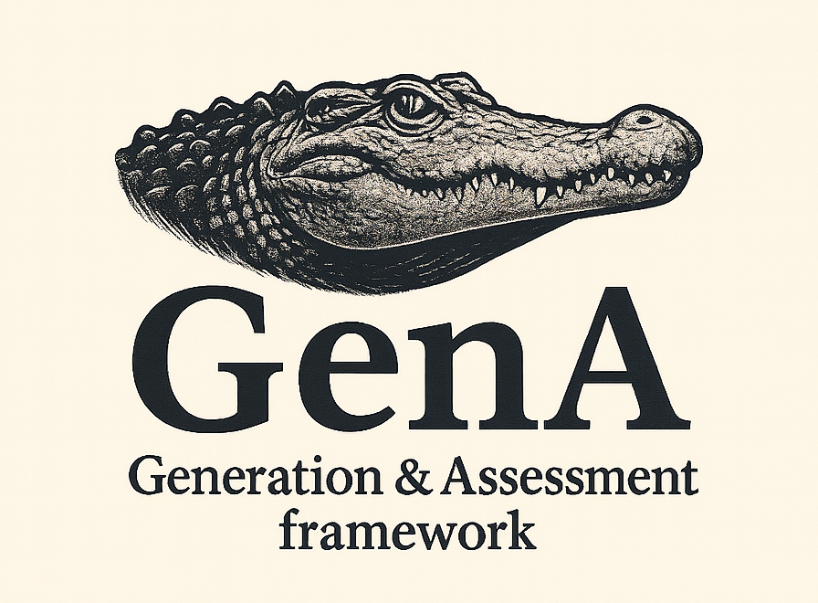
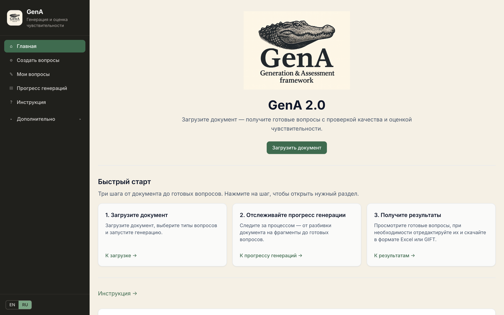
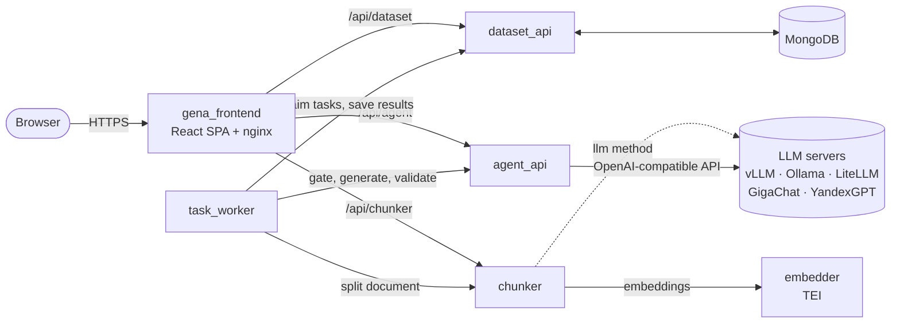
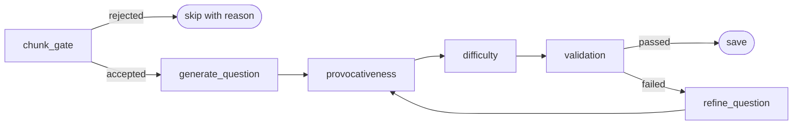
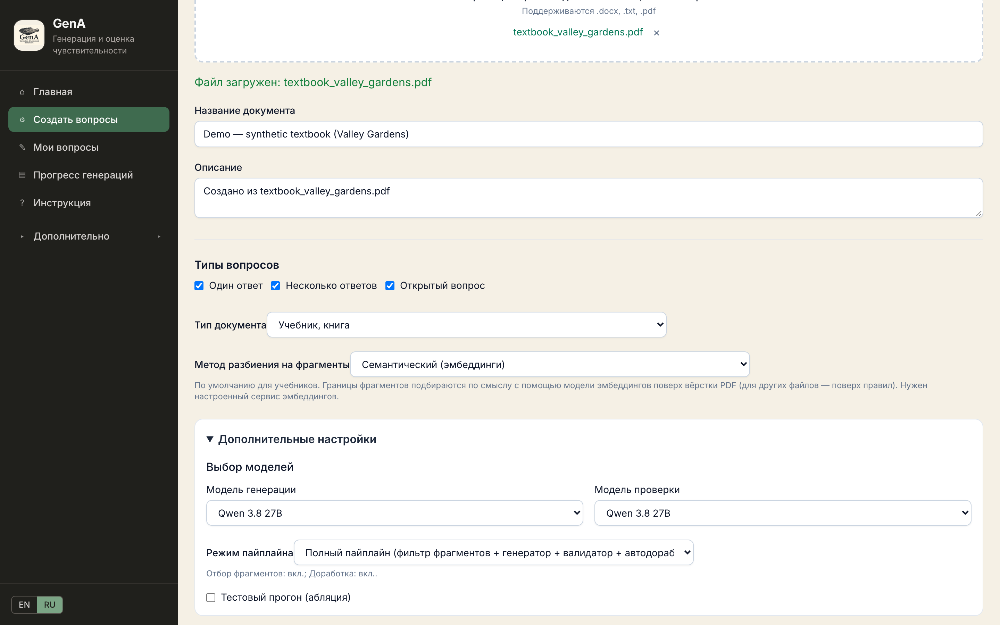
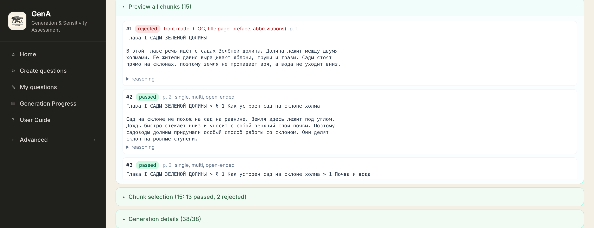
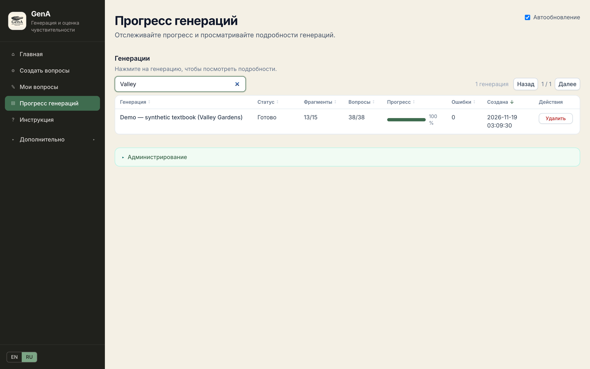
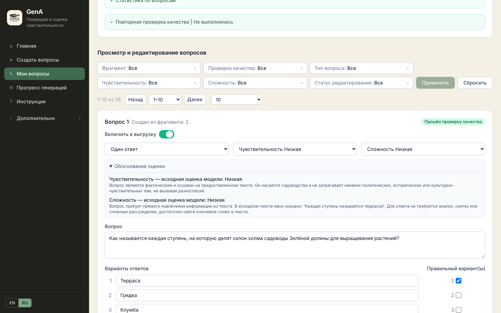

<p align="center">
  
</p>

# GenA — Generation & Assessment Framework

**GenA** turns source documents into validated question banks. You upload a law, a textbook or an
encyclopedia; GenA splits it into fragments, filters out fragments that cannot carry a good question,
generates single-choice, multiple-choice and open questions from the rest, grades each question
against weighted quality criteria, rewrites weak ones, and lets you review, revalidate and export the
result to XLSX (or GIFT for learning management systems).

It is aimed at educators, legal professionals and researchers who build exam, training or evaluation
sets from Russian-language documents (the interface is available in English and Russian).

**Repository:** [github.com/center4aai/GenA](https://github.com/center4aai/GenA) ·
**License:** [Apache License 2.0](LICENSE) ·
**Example question set:** [`GenA_example_question_dataset(rus-eng translation).xlsx`](GenA_example_question_dataset(rus-eng%20translation).xlsx)
(questions generated by GenA, with an English translation)



## Contents

- [Key features](#key-features)
- [Architecture](#architecture)
- [Quick start](#quick-start)
- [Connecting models](#connecting-models)
- [Using GenA](#using-gena)
- [Synthetic documents and tests](#synthetic-documents-and-tests)
- [What's new since July 2026](#whats-new-since-july-2026)
- [Configuration reference](#configuration-reference)
- [Кратко по-русски](#кратко-по-русски)

## Key features

- **Three question types** — `one` (single correct answer), `multi` (several correct answers) and
  `open` (free answer). One question per selected type is generated for every fragment that passes the gate.
- **Fragment gate before generation** (`chunk_gate`). An LLM decides whether a fragment is informative
  and self-contained enough for a question (and, for `multi`, whether it supports several correct answers).
  Rejected fragments are skipped with a reason (`chunk_not_informative`, `chunk_not_self_contained`,
  `chunk_exercise_block`, `chunk_front_matter`, …), so no tokens are spent on tables of contents,
  exercises or imprint pages. Textbooks and encyclopedias get their own gate rules.
- **Chunking methods by document kind.** The chunker knows three document kinds — `normative`
  (laws and regulations), `textbook` (textbooks and books) and `encyclopedia` — and four methods:

  | Method | What it does | Default for |
  |---|---|---|
  | `rules` | Headings plus rule-based splitting (articles, parts, items, sections) | `normative` (the only method allowed for it) and `encyclopedia`; also the API default |
  | `layout` | Reads a PDF with pdfplumber and separates body text from insets, captions and exercises by font, size and background | chosen manually |
  | `semantic` | `layout` (PDF) or `rules` (DOCX/TXT) plus topic boundaries where the embedding similarity of neighbouring paragraphs drops; needs the `embedder` service | `textbook` |
  | `llm` | An LLM labels numbered paragraphs window by window (inset, exercise, caption, toc, …) without rewriting the text; falls back to rules per window on error | chosen manually |

  `GET /chunking-methods/` reports which methods are available with the current configuration;
  details are in [chunker/README.md](chunker/README.md).
- **Validation by weighted criteria.** Each question is scored by an LLM on five criteria blocks
  (question wording, answer options, correctness of the keys, logical consistency, language) with
  per-subcriterion weights; the total is compared with a per-type threshold. A question that fails is
  sent to a refine step and re-assessed, and the best version is kept. Questions are also rated for
  difficulty and provocativeness.
- **Revalidation of a dataset with another model.** A saved dataset version can be re-checked by a
  different model — all questions, only those that require it, only user-edited or only paraphrased
  ones — without regenerating anything. Edited questions are marked as needing revalidation.
- **Any OpenAI-compatible model.** vLLM, Ollama, LiteLLM, llama.cpp and other OpenAI-compatible servers
  are listed in one JSON variable (`MODEL_ENDPOINTS`); GigaChat and YandexGPT have native adapters.
  Models served behind LiteLLM can be discovered automatically. The generation and validation models
  are chosen per run in the UI, the revalidation model per revalidation run.
- **Honest model health.** `GET /models/health/` checks that each model is actually listed by its
  server and periodically sends a one-token test request, so a model with a missing key, a wrong name or
  a dead server is shown as unavailable with a reason instead of failing in the middle of a run.
- **Background queue.** Chunking, gate, generation and validation run in a task queue; you can close the
  tab and follow progress on the *Generation Progress* page. Results are saved incrementally and failed tasks can be retried.
- **Review and export.** Browse and edit questions, switch between dataset versions, read the validator's
  and assessors' rationale and the source fragment, and export generation results or the full pipeline
  data to **XLSX**, or questions to **GIFT**.

## Architecture

| Service | Role |
|---|---|
| `gena_frontend` | React + TypeScript single-page app served by nginx over HTTPS; proxies the APIs under `/api/*` |
| `dataset_api` | FastAPI: datasets, versions, questions, task queue, revalidation runs, auth |
| `task_worker` | Claims tasks from the queue and runs chunking → gate → generation → validation; saves results incrementally |
| `agent_api` | FastAPI + LangGraph: gate, generation, assessment, validation, refine; model registry and health |
| `chunker` | FastAPI: parses PDF / DOCX / TXT and splits by the chosen method (`chunker_gpu` is an optional GPU variant) |
| `embedder` | Hugging Face Text Embeddings Inference (`deepvk/USER-bge-m3`) for the `semantic` method; needs an NVIDIA GPU |
| MongoDB | Datasets, questions, tasks and runs; an existing MongoDB instance configured via `MONGO_*` |



Inside `agent_api`, each task goes through a LangGraph pipeline:



The pipeline mode of a run can switch off the refine step (`generator_validator_gate`) or the gate as
well (`generator_validator`); the default is `full`.

## Quick start

Requirements: Docker with Compose v2, a MongoDB instance, at least one OpenAI-compatible LLM endpoint
(or GigaChat / YandexGPT credentials). The `embedder` service needs an NVIDIA GPU; without one, see the
note below.

```bash
git clone https://github.com/center4aai/GenA.git && cd GenA

# 1. Point GenA at your models (non-secret settings, see "Connecting models")
$EDITOR config/llm_defaults.env

# 2. Create .env: MongoDB connection, API keys, ports
cp env.example .env
$EDITOR .env          # MONGO_*, LLM_API_KEY, JWT/worker secrets, WEB_PORT

# 3. Build and start
docker compose up -d --build
docker compose ps     # wait until the services are healthy
```

Open **https://localhost:27371** (or your `WEB_PORT`). The certificate is self-signed and generated at
image build time: accept the browser warning or put your own certificate / reverse proxy in front.
HTTPS is needed for the browser clipboard API used by the copy buttons.

**Generating `.env` instead of editing it.** `gen_env.sh` writes `.env` from variables in your shell or
CI (`./gen_env.sh dev` or `./gen_env.sh prod`); a variable with the `_DEV` / `_MAIN` suffix wins over the
plain one, so two isolated stacks (different MongoDB databases, ports and container names) can run on
one host. Keys from `config/llm_defaults.env` override both, so the repository stays the source of truth
for model settings. `tests/test_env_contract.py` keeps `env.example`, `gen_env.sh` and the variables the
services read in sync.

**Without a GPU.** Start the stack without the embedder and clear `CHUNKER_EMBEDDING_URL` in `.env`:
`docker compose up -d --build agent_api dataset_api task_worker chunker gena_frontend`. The `semantic`
method is then reported as unavailable; `rules`, `layout` and `llm` keep working.

**GPU chunker (optional).** `docker compose --profile gpu up -d --scale chunker=0` runs `chunker_gpu`
under the same network alias.

Backend ports are not published to the host; the SPA reaches the APIs through its nginx proxy.

## Connecting models

Model settings live in [`config/llm_defaults.env`](config/llm_defaults.env) and contain no secrets:

```bash
LLM_URL_MODEL=http://vllm:8000/v1         # default model for calls without an explicit model id
LLM_MODEL_NAME=Qwen/Qwen3-32B
MODEL_ENDPOINTS='[
  {"id":"vllm-default","name":"Qwen3 32B (vLLM)","base_url":"http://vllm:8000/v1",
   "model_name":"Qwen/Qwen3-32B","api_key_env":"LLM_API_KEY"},
  {"id":"ollama-example","name":"Qwen3 8B (Ollama)","base_url":"http://ollama:11434/v1",
   "model_name":"qwen3:8b","api_key":"none","extra":{"reasoning_effort":"none"}}
]'                                         # one line in the real file
```

- The **first entry** of `MODEL_ENDPOINTS` is the default model in the UI.
- **Keys are never stored in the file.** `api_key_env` names the variable that holds the key (set it
  in `.env`); `"api_key":"none"` is for servers without auth. If the variable is empty, the model is
  not called and `/models/health/` shows it as unavailable with a reason.
- `extra` passes provider arguments, e.g. `reasoning_effort: "none"` for a thinking model served by
  Ollama. For vLLM / llama.cpp GenA always sends `chat_template_kwargs.enable_thinking=false`.
- **Network safety.** `agent_api` refuses outbound calls to private addresses. Host names you put in
  `MODEL_ENDPOINTS` / `LLM_URL_MODEL` (for example a `vllm` or `ollama` container on the compose network)
  are trusted; private IP addresses must be listed in `OUTBOUND_ALLOWED_CIDRS`.
- **GigaChat / YandexGPT.** Set `GIGACHAT_CREDENTIALS`, or `YANDEX_CLOUD_API_KEY` and
  `YANDEX_CLOUD_FOLDER` in `.env`; the models appear in the list automatically.
- **LiteLLM discovery (optional).** With `LITELLM_BASE_URL` and `LITELLM_API_KEY` set, models served
  behind a LiteLLM gateway become available; `ARGOCD_URL` + `ARGOCD_PASSWORD` additionally list vLLM
  deployments managed by ArgoCD. Empty values switch discovery off.

Useful endpoints of `agent_api`: `GET /models/`, `GET /models/health/`, `GET /models/discover/`.

## Using GenA

1. **Create questions** — upload a `.pdf`, `.docx` or `.txt` file (or use the sample document),
   choose the document kind and the chunking method (preselected by kind), the question types
   (`one`, `multi`, `open`; all three if none is chosen) and the models, and start generation.

   

2. **Fragments** — preview how the document was split (*Show chunks*), and later, on *Generation Progress*,
   which fragments the gate selected and which it rejected, with reasons.

   

3. **Generation Progress** — follow the queue from chunking to ready questions: task status, errors, retries.

   

4. **My questions** — review questions with validation scores, the issues found by the validator, the
   assessment rationale and the source fragment; edit, switch versions, start revalidation with another model, export to XLSX or GIFT.

   

5. **Analytics** — scores and outcomes per dataset; run comparison (gate and validation pass rates
   across datasets, including ablation modes on the same document).

## Synthetic documents and tests

Real textbooks and encyclopedias used during development are copyrighted and are not part of this
repository; the tests that need them are skipped. Instead, three fictional documents reproduce the same
layout patterns:

| File (`tests/data/synthetic/`) | Kind | What it exercises |
|---|---|---|
| `textbook_valley_gardens.pdf` | textbook | chapters and §, run-in subheadings, insets on shaded background, captions, "key terms" and exercise blocks, running headers, a paragraph across pages |
| `encyclopedia_valley.pdf` | encyclopedia | two-column entries with bold headwords, a biographical entry, an entry across pages |
| `normative_terraces_law.docx` | normative | chapters and articles as Heading 1/2, parts `1.` and items `1)` |

They are produced by a deterministic generator, [`tests/fixtures/synthetic/build.py`](tests/fixtures/synthetic/build.py)
(see its [README](tests/fixtures/synthetic/README.md)); the texts of the Russian Family Code, Criminal
Code (part) and Constitution in `tests/data/` are official texts in the public domain.

Run the tests:

```bash
pip install pytest -r agent_api/requirements.txt -r dataset_api/requirements.txt \
    -r task_worker/requirements.txt -r chunker/requirements.txt -r requirements-dev.txt
python -m pytest tests/ -q
python -m pytest chunker/ -q          # separate process: chunker/ puts itself on sys.path
cd gena_frontend && npm ci && npx vitest run && npx tsc --noEmit
```

**Your own documents.** Check how a document will be split without running the whole stack, from the
chunker image or an environment with `chunker/requirements.txt`:

```bash
python scripts/chunk_report.py my_textbook.pdf --kind textbook --method semantic --out report.md
python scripts/chunk_report.py my_law.docx --kind normative --method rules --out report.md
```

The report lists blocks by page with their types, what was dropped and why, the resulting fragments and
a length histogram (`--json-out` saves the `/chunk/` response for `scripts/chunk_metrics.py`). Then
upload the same file in the UI to generate questions.

## What's new since July 2026

- **Document kinds and new chunking methods.** Besides laws, GenA now handles textbooks and
  encyclopedias, with `layout`, `semantic` (embedding-based topic boundaries, new `embedder` service) and
  `llm` segmentation next to the rule-based method; the default method depends on the document kind.
- **Kind-aware gate and generation.** The fragment gate and the generation/validation prompts follow the
  document kind (a textbook question must be self-contained, a legal one may cite the article); the gate
  drops exercises, front matter and other non-content blocks with explicit reasons.
- **Validation and revalidation.** Weighted criteria with per-type thresholds, refine that keeps the
  best version, and revalidation of a saved dataset version by another model with scopes
  (all / required / user-edited / paraphrased).
- **Models.** Any number of OpenAI-compatible models in `MODEL_ENDPOINTS` with keys taken from the
  environment, optional LiteLLM / ArgoCD discovery, per-run choice of the generation and validation
  models, and model health based on real requests.
- **New frontend.** The React SPA (`gena_frontend`) is the only UI: queue-based processing with a
  progress page, fragment preview, dataset versions, run comparison, XLSX and GIFT export, English and
  Russian locales.
- **Reliability.** Idempotent task claiming, recovery of stuck tasks, retry policy, graceful worker
  shutdown, configurable LLM timeouts.
- **Synthetic test documents** and a much larger test suite that runs without copyrighted data.

## Configuration reference

All variables with defaults (MongoDB, ports, auth, worker timeouts and recovery, CORS, chunker and
embedder settings) are listed in [env.example](env.example). Model settings are described in
[Connecting models](#connecting-models); chunker settings in [chunker/README.md](chunker/README.md);
validation criteria in [agent_api/agent/nodes/llm_validator/README.md](agent_api/agent/nodes/llm_validator/README.md).
Deployment order and rollback notes: [ROLLBACK.md](ROLLBACK.md).

Before deploying, set secrets (MongoDB password, API keys, JWT and worker secrets) through environment
variables. Do not commit `.env` files or keys.

## Кратко по-русски

GenA строит банки вопросов по документам: нормативным актам, учебникам и энциклопедиям. Документ режется
на фрагменты (методы `rules`, `layout`, `semantic`, `llm`; для нормативки только `rules`, для учебника по
умолчанию `semantic`), гейт отсеивает фрагменты, по которым нельзя задать хороший вопрос, затем
генерируются вопросы с одним, несколькими ответами и открытые, каждый проверяется по взвешенным критериям
и при необходимости дорабатывается. Готовый набор можно перепроверить другой моделью и выгрузить в XLSX.
Модели подключаются через любой OpenAI-совместимый API (vLLM, Ollama, LiteLLM) или GigaChat / YandexGPT:
настройки — в `config/llm_defaults.env`, ключи — в `.env`. Быстрый старт — раздел [Quick start](#quick-start).

## License

This project is licensed under the [Apache License 2.0](LICENSE).

Copyright 2026 [center4aai](https://github.com/center4aai/GenA).
